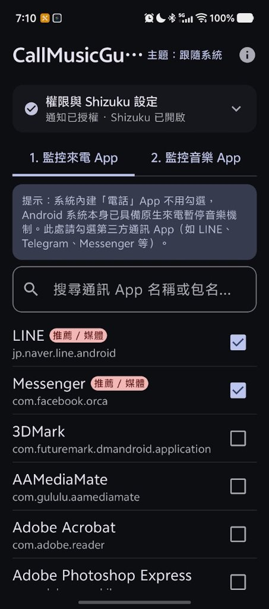
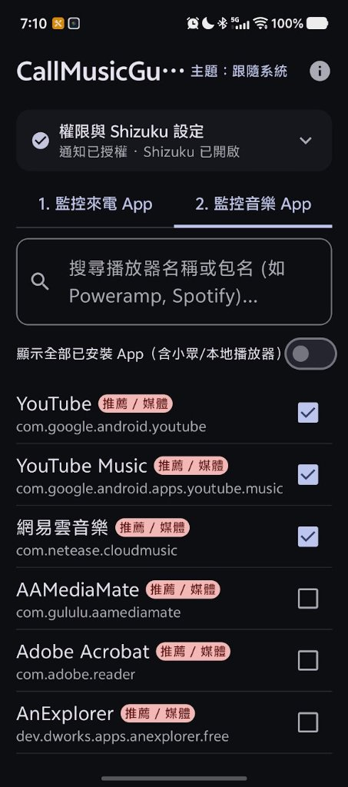
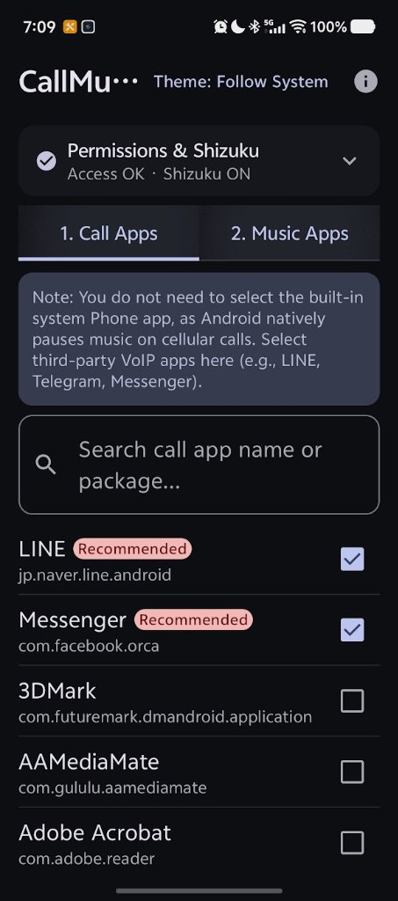
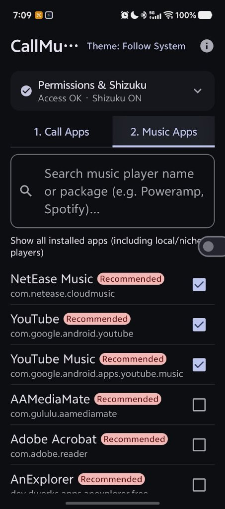

# CallMusicGuard

**免 Root！自動偵測 VoIP 來電並控制音樂播放的 Android 工具（支援 LINE、WhatsApp、Telegram、FB Messenger 等，搭配 Shizuku 使用可獲得最佳效果）**  
**No Root Required! An Android utility that automatically pauses music during VoIP calls (LINE, WhatsApp, Telegram, FB Messenger, etc.) and resumes playback when the call ends — works best with Shizuku.**

> 💡 **免 Root 即可使用，搭配 Shizuku 效果最佳！ / No Root Required — Best Experience with Shizuku!**  
> 無需 Root 權限即可運作；若搭配 **Shizuku** 使用，可一鍵解除 Android 13–15 側載「受限制的設定」鎖定、直接寫入通知存取權與背景保活白名單，防止 OriginOS / ColorOS 等系統在背景殺死服務，並於播放器休眠時強制喚醒恢復播放，獲得最穩定的體驗。  
> Works out of the box without root. Pairing with **Shizuku** unlocks Android 13–15 restricted settings, grants Notification Listener & background keep-alive whitelists in one tap, prevents aggressive OEM background killing (e.g. OriginOS, ColorOS), and reliably wakes frozen players for the best experience.

---

## ✨ 功能特色 / Features

### 繁體中文
- **完全免 Root，搭配 Shizuku 獲得最佳效果**：
  - 不需解鎖 Bootloader 或取得 Root 權限。
  - 啟用 **Shizuku 增強模式** 後，可一鍵寫入 ADB 權限（解除側載受限設定、授予通知存取權、加入背景與電池保活白名單），大幅提升背景穩定度與恢復播放成功率。
- **VoIP 來電自動暫停與恢復**：透過 `NotificationListenerService` 精準辨識第三方通訊軟體（**LINE、WhatsApp、Telegram、FB Messenger** 等）的通話通知，來電時自動暫停正在播放的音樂，無論接聽後掛斷或未接來電，結束後皆會自動恢復播放。
- **兩步驟分頁清單**：
  1. **監控來電 App**：自由勾選需要監控的通訊軟體（系統內建「電話」App 本身已具備原生來電暫停機制，無需勾選）。
  2. **監控音樂 App**：自動偵測音樂播放器，並支援搜尋與「顯示全部已安裝 App」（相容 Poweramp、海貝音樂、UAPP 等小眾／本地播放器）。
- **Material Design 3 與明暗主題**：支援跟隨系統、淺色模式、深色模式切換，並支援 Android 12+ 動態取色（Dynamic Color）。
- **每日自動檢查更新**：開啟 App 時每日自動檢查 GitHub Releases 是否有新版本並顯示更新提醒按鈕；亦可於「關於」頁面手動檢查更新。
- **多國語系支援**：繁體中文（台灣／香港）、簡體中文、英文、日文。

### English
- **No Root Required — Best Experience with Shizuku**:
  - Works without unlocking the bootloader or rooting your device.
  - Enabling **Shizuku Enhanced Mode** lets you grant ADB permissions in one tap (unlocking sideloaded restricted settings, enabling Notification Access, and applying background/battery keep-alive whitelists), ensuring maximum background reliability and playback recovery.
- **Auto Pause & Resume on VoIP Calls**: Uses `NotificationListenerService` to detect incoming/ongoing VoIP calls from third-party messaging apps (**LINE, WhatsApp, Telegram, FB Messenger**, etc.). Automatically pauses active music players on call start and resumes playback after the call ends or is missed.
- **Two-Step Tabbed Selection**:
  1. **Call Apps**: Select the VoIP apps you want to monitor (no need to select the built-in system Phone app, as Android natively handles cellular call audio focus).
  2. **Music Apps**: Auto-detects media players with search filtering and a "Show all installed apps" toggle (works with Poweramp, HiBy Music, UAPP, Spotify, etc.).
- **Material Design 3 & Light/Dark Theme**: Supports Follow System, Light, and Dark modes, plus Android 12+ Dynamic Color.
- **Daily Auto-Update Check**: Automatically checks GitHub Releases once a day for new versions and displays an update prompt button; manual check is also available in the About dialog.
- **Multi-language Support**: English, Traditional Chinese (TW/HK), Simplified Chinese, and Japanese.

---

## 📸 介面預覽 / Screenshots

### 繁體中文介面 (Traditional Chinese)
| 1. 監控來電 App | 2. 監控音樂 App |
| :---: | :---: |
|  |  |

### 英文介面 (English)
| 1. Call Apps | 2. Music Apps |
| :---: | :---: |
|  |  |

---

## 📥 下載安裝 / Download & Install

前往 [**Releases 頁面**](https://github.com/dx9901mk5/CallMusicGuard/releases) 下載最新版本的 `CallMusicGuard-v*.apk` 並安裝即可。  
Go to the [**Releases page**](https://github.com/dx9901mk5/CallMusicGuard/releases) and download the latest `CallMusicGuard-v*.apk`.
